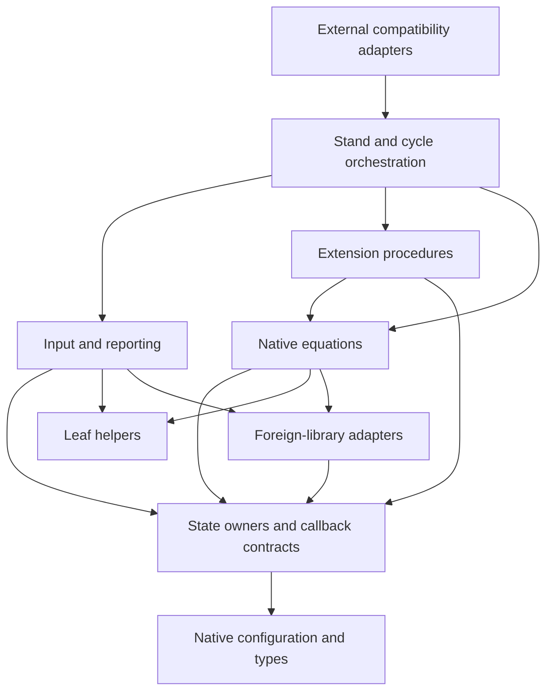

# Module migration inventory and ownership

Phase 1 source/design inventory, 17 November 2026. Its source reference is
main `d31a9ff0d0a51e1f0622d0a9b8d431dd310b54c4`, with NVEL
`2503c0de71cb07b7d04c4d2edba38a3ff27237fc`. No simulation procedure, COMMON
declaration, equation, initialization or restart layout changes in this phase.

## Scope and regeneration

The principal migration covers the internal Fortran selected by all 24 live
`bin/FVSxx_sourceList.txt` manifests, including metric paths, linked extension
stubs, existing modules and the executable/library adapters. GNU Make and the
GNU CMake path remain supported build inputs. Compiler-specific Windows/Intel
aliases and annotations remain compatibility boundaries; native Windows and
Intel execution were not verified here. MOD06 must verify dependency changes
on each build path before a migration uses them.

NVEL and ORGANON implementation internals, SQLite, FOFEM and CFIM remain named
library boundaries. Their selected Fortran procedures, shared state and import
sites are indexed, but this principal phase does not rewrite their internals.
The `vorganon`/volume/database/fire adapters on the mFVS side remain in scope.
Standalone NVEL SDK/Visual Studio targets and unselected sources are outside
this migration; a live-manifest exclusion does not authorize their removal.

The Make executable and per-variant shared library use the same manifests;
CMake additionally groups SQLite/FOFEM into libraries. The clients in
`tests/APImemTables`, `tests/APIviaR` and `tests/AllCycleActivities`, and the
C shims in `base/apisubsc.c`, are external API consumers. Packaging must retain
the executable, library and public calling contracts.

Regenerate or inspect the inventory without retaining a generated archive:

```sh
python3 -B tests/parity/module_inventory.py
python3 -B tests/parity/module_inventory.py --procedure ISTFNB
python3 -B tests/parity/module_inventory.py --common DMMIST
python3 -B tests/parity/module_inventory.py --json
python3 -B tests/parity/test_module_inventory.py
```

The [indexer](tests/parity/module_inventory.py) reads every live manifest and
its include lookup view. Each definition has a source/line/scope identity,
native variants and a migration family. It records signatures, ENTRY groups,
interfaces, module USE/visibility, DEC ABI annotations, direct calls, known
function references and passed procedures. Each COMMON source layout retains
ordered members, declarations, native include sources, consumers, reference
sites, direct assignments, possible call/I/O mutations and proposed ownership.
SAVE/DATA/declaration-initialized locals, derived types, module objects and
EQUIVALENCE sites are also indexed. Repeated COMMON fragments are joined in
source order; differently named fields in another scope remain separate layouts.

This is a conservative lexical index. CPP alternatives remain visible, and
native PRGPRM declarations give the variant-dependent dimensions. A possible
mutation is an audit site, not proof of INTENT(OUT). It does not prove alias
safety, branch reachability or readonly DATA tables. The named migration batch
must check those contracts with source inspection and the compiler before it
adds INTENT, changes storage or updates callers. No interfaces are generated
from guessed types. New source roots and unowned COMMON names fail the index.

## Procedure families and compatibility boundaries

The current union contains 1,541 selected paths and 1,355 Fortran compilation
sources. It has 2,123 scoped units: 1,903 subroutines, 104 functions, 87 BLOCK
DATA units, 28 modules and one program. There are 366 ENTRY declarations and
31 statement functions. These counts include selected library boundaries and
different native definitions of the same external name.

| Inventory family | Scoped units | Migration treatment |
|---|---:|---|
| MOD09 API | 60 | Executable, command-line, C/Fortran and memory-table adapters; preserve symbols and argument conventions. |
| MOD10 helpers | 4 | Small shared helpers; the first bounded batch is ISTFNB only. |
| MOD11 database | 80 | Input/output bindings and resources, one writer/reader family at a time. |
| MOD11 input/report/expression | 66 | Keyword readers, reports and expression handling. |
| MOD12 equations | 487 | Native equation/volume/dispatch families, preserving selected species layouts. |
| MOD13 core | 288 | Stand/cycle control, treatments, tree updates and initialization. |
| MOD13 restart | 22 | Stop/restart adapters and primitive packing; preserve formats. |
| MOD14 extensions | 515 | Separate fire, establishment, sprouts, mistletoe/NISI, root disease, cover, climate, economics and ORGANON adapters. |
| NVEL boundary | 423 | Preserve library internals and their existing module/data contracts. |
| ORGANON boundary | 178 | Preserve library internals, native arrays and persistent helper state. |

MOD08/09/25 are also cross-cutting requirements: a family assignment never
waives ENTRY, callback, exported-symbol or BLOCK DATA work. Expand each family
by named source/routine batches before migration.

Duplicate names across disjoint variant manifests are native implementations,
not duplicate definitions to coalesce. `DGCONS` illustrates an intentional
signature split: the common executable include has no argument, while EM's
include accepts IDTYPE. The index attaches both to the selected DGF host with
their own variant sets. DUBSCR, NATCRS and volume entry contracts likewise
remain selected/native contracts. A module must not unify them by padding or
casting arguments.

Name resolution also distinguishes COMMON/component arrays, local statement
functions and external functions: for example BC's BB coefficient array is
not NVEL's BB function. The real procedure arguments found in the live source
are RANN, ESRANN and SVRANN, passed at 98 sites. BACHLO's RANGEN dummy calls
need a checked callback contract under MOD08. Keep each stream's identity,
argument mutation and draw sequence. EXMIST's unreachable CBUFF references
belong to its ENTRY-buffer contract review, rather than an inferred callback
migration. Compiler/runtime calls and CFIM_DRIVER/FM_FOFEM/SQLite calls are
named boundaries in the index.

All existing top-level/ENTRY Fortran symbols are compatibility candidates,
including names not marked DLLEXPORT in source: GNU shared libraries expose
legacy externals without those annotations. Keep external adapters until
MOD09 accounts for their consumers. Preserve C BIND names, DEC aliases, hidden
character lengths, kinds, by-reference/value conventions and exported COMMON
backing storage. The inventory includes 1,317 distinct top-level procedure
names before ENTRY names; that is not a claim that each is a documented API.

## Shared-state ownership and lifetime

The index finds 99 named COMMON blocks in 103 source/scope layouts, assembled
from 116 COMMON statements. In particular DMMIST's fourteen statements append
one layout. Native dimensions stay tied to their selected PRGPRM, and TAPER
and SITEFPRM keep their separate declaration/alias views.

The owners below are proposed declaration/storage owners. They do not move
initialization into a module declaration. Preserve the existing linked process
storage during the principal migration, and retain the current process/stand/
cycle reset boundaries. A block can mix values with different reset times.
The source index supplies its actual writers and possible mutation sites;
each block batch must resolve member-level resets before moving declarations.

| Proposed owner | Complete COMMON membership |
|---|---|
| MOD22 tree/work | ARRAYS, WORKCM |
| MOD23 stand/cycle/input | CONTRL, CONCHR, PLOT, PLTCHR, OPCOM, OPCHR, GLBLCNTL, GLBLCNTLC, KEYCOM, CKEYFN, INTREECOM, QFACOM |
| MOD19 reports | OUTCOM, OUTCHR, SUMTAB, SCREEN, FVSSTDCM, GENRCM |
| MOD19 visualization | SVDATA, SVDEAD, SVRCOM |
| MOD19 database | DBSCOM, DBSCHR, DBSTK, DBCHR |
| MOD21 growth/calibration | COEFFS, CALCOM, CALDEN, CICOM, HTCAL, MULTCM, PDEN, SSTGMC, STDSTK |
| MOD21 regional/volume | BCPLT1, BCPLT2, BECREF, CRCOEFFS, CRCOM, DGCOEFFS, VARCOM, VARCHR, KOTCOM, V23DUB, V2PLOT, SECOM, TAPER, VOLMET, VOLSTD, VOLCHR, FVSVOLCOM |
| MOD20 fire/fuels | CFIMCOM, CRBCOM, FMCOM, FMFCOM, FMOPCM, FMSVCM, FMBLK2, CWDCOM |
| MOD20 establishment | ESCOM2, ESCOMN, ESHAP, ESHAP2, ESHOOT, ESTCOR, ESTREE, ESWSBW, HVDNCM |
| MOD20 mistletoe/NISI | MISTL, MISTL2, MISTL3, DMBCCM, DMMIST |
| MOD20 root disease | PRPDAT, PRPDATD, RDADD, RDARRY, RDCOM, RDCRY |
| MOD20 climate | CLIMATE, CLIMCHR |
| MOD20 cover | CVCOM |
| MOD20 economics | ECON, ECON1, ECONSAVE |
| MOD20 other extensions | EMCOM, FFCOM, TWIGCOM |
| MOD24 separate RNG streams | RANCOM, ESRNCM, DMRNCM, RRANN |
| ORGANON boundary/shared adapters | ORGANON, GGCOM, INFO, SITEFPRM |
| SP07 with the RDBLK1 BLOCK DATA (deferred from SP04's owner, VARCFG_MOD) | METRIC |

PRGPRM, FMPARM and declaration-only parameter definitions form the configuration
layer. Preserve compiled VARIANTCD/LMETRICVAR and every native value/kind/bound;
runtime VARACD is not a substitute before GRINIT. Parameter statements and
derived-type definitions are retained in the include index. DATA alone does
not make a table immutable.

There are 873 scopes with saved, DATA-initialized or module-owned objects and
38 scopes with EQUIVALENCE. Persistent local objects retain their procedure
owner and existing process lifetime; they are not automatically promoted to
module variables. Host-associated state remains attached to its host. The
three mutable NVEL module owners are DEBUG_MOD, R8VLIST and VOLINPUT_MOD;
their imported users/read/write sites are indexed separately. CHARMOD,
CLKCOEF_MOD and MRULES_MOD supply types, rather than mutable instances.
Existing mFVS modules can still use COMMON within their procedures, so an
empty module-global list does not establish a stateless procedure.

Initialization owners include the selected BLKDAT/CUBRDS/FMCBLK/RDBLK1 units,
KEYWDS, SVBLKD, ESBLKD, DMBLKD, DBSBLKD and SETGLBLCNTL. Preserve their linkage
and startup timing. GRINIT, keyword processing and extension initialization
own stand setup; cycle drivers and extension routines own later updates.
RANSED/RANNGET/RANNPUT and the establishment/SVS/root-disease equivalents
preserve separate seed/reset contracts. Do not replace an initialization
owner with a DATA/default initializer merely because both produce zero in
one test.

Database/file state requires both Fortran and foreign owners. DBSCOM/DBSTK,
CONTRL and GLBLCNTL carry handles, units, case/stand controls and filenames;
`dbsqlite/fvsqlite3.c` owns the process connection/statement arrays dbset and
stmtset. DBSTABLES getters share that statement slot with writers. Preserve
DBSOPEN/DBSCLOSE, stand/case creation, API stop-point access and error cleanup.
CFIM/FOFEM/SQLite private state remains in its named library boundary.

## Aliases, serialization and deferred contracts

GETSTD/PUTSTD alias IOSUM through ROSUM, seeds through two-real buffers,
IDTREE through RDTREE, and WK6 through real/logical/integer work arrays.
IOSUM is 22 rows while the legacy ROSUM view is 20; preserve the existing
packing and transfer counts until MOD17 has an explicit compatibility design.
An alias view is not permission to change a restart format or array stride.

The serializer map also includes `pg/putgetsubs`, cover/economics/fire
GET/PUT pairs, `clim/base/clputget`, `dbsqlite/dbsppget`/`dbsppput`, mistletoe
MSPPGT/MSPPPT, root-disease RDPPGT/RDPPPT and native VARGET/VARPUT. Their actual
primitive transfer calls and buffer arguments are in the procedure index.
Other alias sites include compression/statistics/tree workspaces, label/
expression buffers, BC fitted tables, establishment plot arrays, SVS work
buffers, metric stand input, root-disease seed packing and HTGF tables.
No migration may create a second backing store and synchronize copies.

The corrected reference retains known defects. These are bounded exclusions
or prerequisites for their affected batches, not prerequisites for ISTFNB:

- Bug 66: transaction failure/ownership behavior before database resource-state
  migration or a batch that changes those error paths.
- Bugs 52/53 and the remaining R9DIB issue in bug 6: undefined/error inputs in
  the NVEL boundary. Preserve the documented direct-test controls and limits.
- Bug 13 and the remaining undefined/debug paths in bugs 8, 17–19, 36–39,
  45 and 56 (46 and 47 have since been repaired): review the particular
  ENTRY/procedure batch; do not add casts,
  blanket initialization or permissive interfaces to force it through.
- Bug 63: GNU initialization flags miss locals in procedures with ENTRY;
  ordinary output agreement is not a proof that those locals are defined.
- Bug 60: RDPR's saved LYAREA is deliberately absent from restart data. The
  first report in a new process starts from zero. Existing IE restarted and
  continuous runs also differ in six tables; preserve each reference path
  rather than claiming those two modes are equivalent.

Deterministic equation/unit/report defects can remain frozen during an
independent structural batch. Its affected paths still need defined,
repeatable comparisons. Record any newly established defect separately.

## Variant configuration and name collisions (SP01, SP02)

Added 19 November 2026 at `f17ff270`. Both reports come from the same index:

```sh
python3 -B tests/parity/module_inventory.py --configuration [--detail]
python3 -B tests/parity/module_inventory.py --collisions [--detail]
```

The summary form prints the tables below; `--detail` prints every classified
site, implementation, signature, caller and batch as JSON. Like the rest of
the index, both are lexical and conservative: they direct the SP04–SP12
batches to their sites, and each batch still checks the sites it changes.

### SP01: compile-time variant inputs

Seven `PRGPRM` values differ by variant: `MAXSP` (11 to 108), `MAXTRE` (3,000,
4,000, 6,000, with `MAXTP1` = `MAXTRE`+1), `MAXPLT` (200 or 500), `NSPSPE`
(sprouting species, 1 to 87), `MXFRCDS` (forest codes, 20 or 23), and the
identities `VARIANTCD` and `LMETRICVAR`. The audit listed the first five;
`NSPSPE` and `MXFRCDS` are extents too and are handled like `MAXSP`. Three
includes differ by variant: `PRGPRM` (24 versions), `FMBIOGRP` (3) and
`DGCONS_ENTRY` (2). BLOCK DATA has 87 units under 10 names, five of them
per-variant: BLKDAT ×24, FMCBLK ×21, CUBRDS ×20, RDBLK1 ×15 and ESBLKD ×2.

Every statement that names one of these inputs, or the runtime `VARACD`,
has one kind and a use (4,715 statements outside `PRGPRM` after SP04;
4,729 at SP01):

| Kind | Statements | Uses |
|---|---:|---|
| Active extent | 2,059 | loop bounds (MAXSP 976, MAXTRE 97, MAXPLT 17, NSPSPE 26), call arguments (MAXSP 467, MAXTRE 37), bound checks, array sections, other expressions, and the dead-record start `MAXTP1` (56) |
| Identity test | 1,360 | `VARIANTCD` 510 compile-time tests and 1 declaration (the VARCFG_MOD copy); `LMETRICVAR` 349 and 1; `VARACD` 477 runtime tests, 20 assignments, 2 declarations. SP04 removed the 11 `VARIANTCD` and 5 `LMETRICVAR` parameter expressions |
| Storage dimension | 978 | declarations (MAXSP 686, MAXTRE 230, MAXPLT 42, NSPSPE 10, MXFRCDS 2) and 8 size parameter expressions |
| Initializer | 318 | DATA using MAXSP (278, plus 38 with literal repeat counts), NSPSPE (1) and `VARACD` (1) |

Flags mark the restart serializers (`pg/putstd.f90`, `pg/getstd.f90`: MAXSP
210, MAXPLT 12, MAXTRE 4 statements) and the API adapters (MAXSP 31, MAXTRE 4,
MAXPLT 1). The `VARIANTCD` parameter expressions that were in `vbase/dgf.f90`,
`estb/esaddt.f90`, `estb/esfltr.f90`, `fire/base/fmcba.f90`,
`fire/base/fmsnft.f90` and `vbase/crown_pn.f90`, and the `LMETRICVAR` ones in
`base/evldx.f90`, `base/stats.f90` and `dbsqlite/dbsin.f90`, now read the
runtime copies in VARCFG_MOD (`base/varcfg_mod.f90`, SP04); the inventory
test requires that none return.

Link-time selection: of the files not linked by every variant, 709 hold
alternate implementations of a colliding name, 10 are extension stubs
(`base/ex*.f90` and `fire/base/excfim.f90`, `exhtdbh.f90`), 183
are variant-only code with no name conflict (they simply join the single
program), 120 are NVEL (every variant but BC) and 12 are C/C++ (BC's CFIM).

The counts reconcile with the plan's audit, which counted lines and included
the 24 `PRGPRM` files: `VARIANTCD` 884 code lines in 36 files, plus 48
`PRGPRM` lines, gives the audit's 932 lines in 60 files; `LMETRICVAR` 354 in
62 plus 48 gives 402 in 86; `VARACD` is 589 lines in 123 files in both;
`do ...,MAXSP` is 974 lines in 310 files (audit 972); `do ...,MAXTRE` is 97;
other MAXSP lines are 1,857 (audit about 1,900); DATA statements using MAXSP
are 316 (audit 309, which counted lines); BLOCK DATA is 87 in both.

### SP02: names defined more than once

211 external names (procedures, ENTRY points and named BLOCK DATA) have more
than one definition across the 24 manifests, with 746 extra definitions and
957 implementations; the audit estimated 211 and about 750. No name is
defined twice for one variant. The audit's six apparent same-variant
duplicates (CFTOPK in BC/ON, BALMOD in CS/LS/NE, R9CLARK in ON) are explicit
`interface` bodies, not definitions. Module procedures are excluded, since
their module names them at link time.

| Task | Names | Implementations | Kinds |
|---|---:|---:|---|
| SP10 | 72 | 487 | 64 variant equation families and 8 metric twins outside fire and establishment |
| SP11 | 22 | 149 | per-variant fire code, including the metric fire twins |
| SP08 | 84 | 203 | extension stub and real implementation pairs, including FMCANC, FMCFIM and HTDBH |
| SP09 | 30 | 97 | establishment and sprouting alternates, including metric |
| SP12 | 3 | 21 | RDBLK1, VOLS and EM's DGCONS entry |

622 of the 957 implementations keep SAVE/DATA locals, which SP07 and the
dispatchers must keep per implementation. BRATIO has the most callers (85),
then HTCALC (41) and VOLEQDEF (31).

**Batch order.** Levels come from the call graph among colliding names: a
family's level is one more than the highest level it calls. There are no
cycles. `--collisions` prints the full list per task. Levels run 0–3 in
SP10 (level 0 includes BRATIO, CUBRDS, GRINIT, BLKDAT, DUBSCR and the R*_EQN
volume families; INITRE and RCON are at level 3), 0–4 in SP11 (FMPOFL is the
deepest), 0–2 in SP08 and SP12, and 0–5 in SP09, which has no level 2. Within a
level the names do not call each other and can be batched freely.

**Proposed names.** An implementation linked by one variant becomes
`NAME_XX`. A file shared by several variants takes its family tag from the
file name where it has one (`vbase/crown_pn.f90` gives `CRCONS_PN`,
`mistoe/misintca.f90` gives `MISINT_CA`), otherwise `STUB` for `base/ex*.f90`,
`METRIC` for `metric/`, its region directory (`ie/cftopk.f90`, linked by 23
variants, gives `CFTOPK_IE`), or its directory name (`MISTOE`, `RD`, `ECON`,
`ESTB`, `STRP`). NVEL already defines `FORMCL_BM`, `_CA`, `_EC`, `_PN`, `_SO`
and `_WC`, so those six FVS implementations fall back to `FORMCL_FVS_XX`.
No proposed name clashes with another or with an existing name.

**Signature mismatches** (a dispatcher needs one interface): 29 names differ
in argument count, 8 only in rank and 4 in types.

* Argument count: BALMOD (NE 3; CS, LS, ON 6), DUBSCR (2, 5, 6 and 8),
  HTCALC (6, 7, 8, 11 and 14), SMHTGF (5 to 11), LOGS, SICHG, PVREF1, PVREF4,
  FNDAG, VARMRT, NATCRS (ON 13, U.S. 21), DBSSUMRY (metric 28, U.S. 30),
  DGCONS (EM 1, others 0), ten establishment routines between AK and the
  others (ESADVH, ESPADV, ESPREP, ESPSUB, ESPXCS, ESSPRT, ESSUBH, ESTIME,
  ESTOCK, ESTPP, ESXCSH), and stub/real pairs ECVOL, FFIN, MISINF, ORGTAB and
  ORIN.
* Rank only (a stub declares a scalar where the real routine takes an
  array): ECHARV, ECIN, MISCPF, MSCHGET, MSCHPUT, RDESTB, RDPPGT, RDPPPT.
* Types: HABTYP (`character(len=10)` versus BC's `len=20`), GETEQN (ON's
  `len=10` versus `len=11`), FMCFIM (BC's real routine takes a real flame
  height where the `excfim` stub declares an integer) and ESNSPE, where AK's
  `(IFT,PSPE,ITPP,DEBUG,JOSTND)` and the shared `(PSPE,TPPLN,ISER,ITPP,TPP)`
  are unrelated routines that share a name.

A name whose implementations disagree cannot get one dispatcher with the
original interface. Its batch must either give the dispatcher an interface
that covers every caller, as SP02's callers list allows, or keep the
implementations reachable only from callers of the matching variant, as
ON's NATCRS already is through the bug 55 adapter. The stub mismatches end
when SP08 replaces the stubs.

## Target module layers and first pilot

Arrows mean imports. Callback contracts belong below implementations, and
lifecycle code initializes data owners, keeping the proposed dependencies
acyclic:



The MOD07 pilot is **ISTFNB only**, selected by all 24 variants. It is a
default-integer function of one `character(len=*)` argument, with one internal
call at `vbase/sumhed.f90`. It has no includes, callees, ENTRY, COMMON, SAVE,
DATA, RNG or argument writes. ALGSLP was considered but has 164 call sites in
46 source files; it is a later batch.

Use a new `base/istfnb_mod.f90` containing ISTFNB in ISTFNB_MOD, with private
defaults and only ISTFNB public. Update SUMHED with `use ISTFNB_MOD, only:
ISTFNB`, removing its conflicting local type declaration of that name. Keep
`base/istfnb.f90` as the external compatibility wrapper, importing the module
function under a local alias and preserving its integer result and assumed-
length character ABI. Leave ISTLNB, SUMHED's COMMON declarations and its
formatting unchanged. Both sources remain selected in every manifest.

Pilot assessment ran 87,381 direct strings against Fortran VERIFY, including
zero length, blanks, ordinary characters, tabs and NULs, with input preservation
and diagnostic flags. Five title/header cases compiled and ran through the
real SUMHED in all 24 variants; only REVISE was a fixed test stub. Screen
output is not part of the suite's normal file comparison, so MOD07 must retain
a focused SUMHED output check as well as the full corrected/immediate suites.
Add its incompatible-call compiler control during MOD07. No procedure has
been moved and no module or state owner has been implemented in Phase 1.

MOD07 (19 November 2026) carried out this design as written; ISTFNB_MOD's
argument is `intent(in)`, since the function only reads it. The retained
check is `tests/parity/check_istfnb_pilot.py`, which covers the same string
set, seven titles and the compiler control; see the plan for the outcome. The
index's call resolution is lexical: it lists SUMHED's call against both the
module function and the external wrapper, and it does not follow the
wrapper's renamed import. Later batches should not read a second listed
definition as a second implementation without checking the caller's USE.
